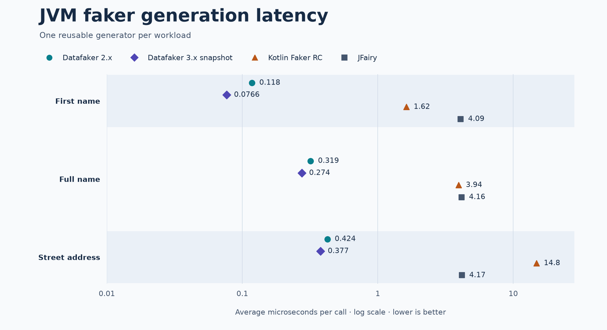

# JVM faker performance

This comparison measures first-name, full-name, and street-address generation for four JVM faker builds. All results are from the same machine on 28 November 2026.

| Library | Build tested |
| --- | --- |
| Datafaker 2.x | [2.7.0](https://central.sonatype.com/artifact/net.datafaker/datafaker/2.7.0) |
| Datafaker 3.x | [3.0.0-SNAPSHOT at `b9762fc5`](https://github.com/datafaker-net/datafaker/commit/b9762fc51990ef1bf09723b577492bc2454364c2) |
| Kotlin Faker | [2.0.0-rc.13](https://central.sonatype.com/artifact/io.github.serpro69/kotlin-faker-jvm/2.0.0-rc.13), release candidate |
| JFairy | [0.10.0](https://central.sonatype.com/artifact/com.devskiller/jfairy/0.10.0) |

## Generation latency

Each dot shows the mean. The horizontal axis is logarithmic and lower values are faster. The table shows microseconds per operation with JMH’s reported error.

| Workload | Datafaker 2.7.0 | Datafaker 3.0 snapshot | Kotlin Faker | JFairy |
| --- | ---: | ---: | ---: | ---: |
| First name | 0.118 ± 0.011 | 0.077 ± 0.003 | 1.624 ± 0.033 | 4.093 ± 0.045 |
| Full name | 0.319 ± 0.007 | 0.274 ± 0.018 | 3.941 ± 0.039 | 4.156 ± 0.050 |
| Street address | 0.424 ± 0.042 | 0.377 ± 0.039 | 14.835 ± 0.236 | 4.173 ± 0.085 |

The Datafaker 3.0 snapshot had 35% lower mean first-name latency and 14% lower mean full-name latency than 2.7.0 in this run. The street-address error intervals for the two Datafaker builds overlap.

## Allocation

These are the bytes allocated per operation, rounded to the nearest byte, as measured by the JMH GC profiler.

| Workload | Datafaker 2.7.0 | Datafaker 3.0 snapshot | Kotlin Faker | JFairy |
| --- | ---: | ---: | ---: | ---: |
| First name | 123 | 5 | 6,572 | 9,898 |
| Full name | 455 | 197 | 13,163 | 9,943 |
| Street address | 788 | 420 | 37,953 | 9,964 |

## Method

Each trial reused one English-language generator on one worker. Both Datafaker versions used the same JMH benchmark class. Each library ran in a separate build and JVM with its own dependencies. The workloads use each library’s usual public API. JFairy generates a `Person` before returning the requested name or first address line, which contributes to its measured time.

JMH 1.37 ran on Corretto 17.0.19 (arm64) on an Apple M2 Pro with 32 GB RAM and macOS 26.5.1. Each workload used three JVM forks, four 500 ms warmup iterations, and five 500 ms measurement iterations per fork. Each fork used a 512 MiB heap.

See the [benchmark sources and reproduction steps](https://github.com/datafaker-net/datafaker-benchmark/tree/b2f3795f1c3e5756c5d8eb147d98a651676cad5a/comparisons/jvm-fakers) to run all four builds or regenerate the chart.
